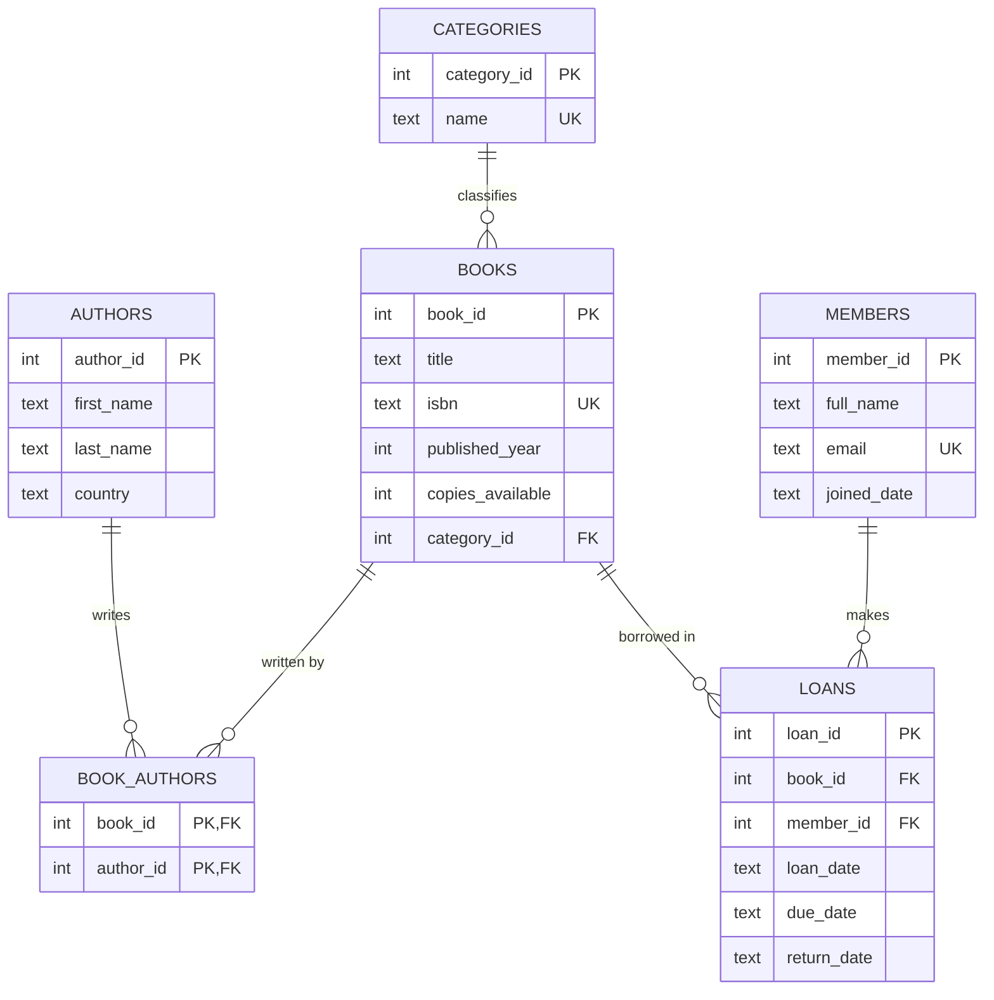

# Library Management System: ERD

## Relationships
- A category has many books; each book belongs to one category (1:N).
- Books and authors are many-to-many, resolved by `book_authors`.
- A member can have many loans; a book can appear in many loans (1:N each).
- `return_date` is NULL while a loan is still open.
